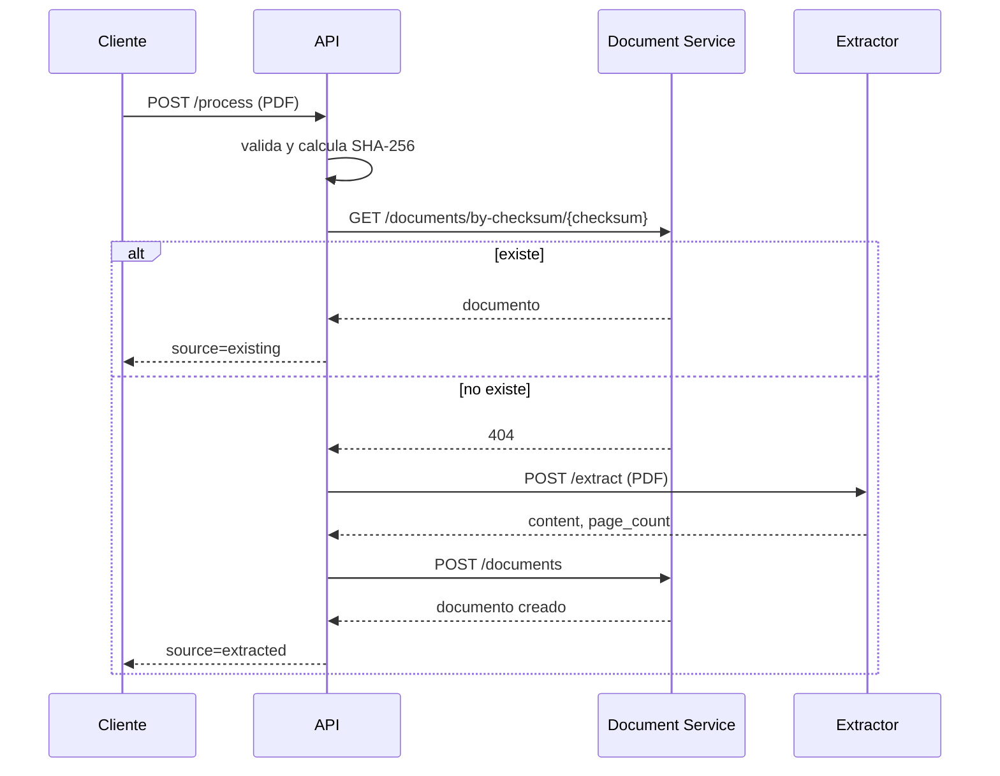

# pdf-api-service

API de entrada y orquestación para PDF-Extractext. Recibe un PDF, valida su formato y tamaño, calcula SHA-256, consulta si ya existe, llama al extractor cuando hace falta y persiste el resultado mediante Document Service. No extrae texto, no accede a MongoDB y no comparte código con otros repositorios.

## Flujo



El Document Service responde 201 cuando guarda un documento nuevo y 200 cuando el checksum ya estaba guardado. Si el POST de creación devuelve 409 por una carrera, la API vuelve a consultar por checksum y devuelve el documento existente.

## Endpoints

- `POST /process`: acepta `application/pdf` binario o `multipart/form-data` con campo `file`. En binario puede enviarse `X-Filename`; si el nombre no termina en `.pdf` se usa `document.pdf`.
- `GET /health`: liveness, sin consultar dependencias.
- `GET /ready`: consulta `/health/ready` de extractor y Document Service.
- `/docs` y `/openapi.json`: contrato interactivo.

Ejemplos PowerShell:

```powershell
curl.exe -k -X POST https://api.universidad.localhost/process `
  -H "Content-Type: application/pdf" -H "X-Filename: informe.pdf" `
  --data-binary "@.\informe.pdf"

curl.exe -k -X POST https://api.universidad.localhost/process `
  -F "file=@.\informe.pdf;type=application/pdf"

curl.exe -k https://api.universidad.localhost/health
curl.exe -k https://api.universidad.localhost/ready
```

## Configuración

Copiar `.env.example` a `.env` para desarrollo y ajustar valores. No versionar `.env` ni secretos.

| Variable | Default | Uso |
|---|---:|---|
| `EXTRACTOR_URL` | `http://extractor:8000` | URL base del extractor |
| `DOCUMENT_SERVICE_URL` | `http://documents:8000` | URL base de documentos |
| `PORT` | `8000` | Puerto HTTP |
| `MAX_UPLOAD_BYTES` | `20971520` | Máximo de carga, 20 MiB |
| `EXTRACTOR_TIMEOUT_SECONDS` | `30` | Timeout de extracción |
| `DOCUMENT_TIMEOUT_SECONDS` | `5` | Timeout de llamadas a documentos |
| `READY_CHECK_TIMEOUT_SECONDS` | `2` | Timeout por health check |
| `MAX_CONCURRENT_REQUESTS` | `0` | Límite de procesos; cero desactiva backpressure |
| `LOG_LEVEL` | `INFO` | Nivel de logs a stdout |
| `TRAEFIK_API_HOST` | `api.universidad.localhost` | Host del router Traefik |

Dentro de Docker, usar DNS de servicio (`extractor`, `documents`), nunca `localhost`.

## Instalar, ejecutar y testear

Requiere Python 3.12 y `uv`:

```powershell
uv sync --locked
uv run --locked pytest -v
uv run uvicorn app.main:app --reload --port 8000
```

La suite unitaria usa mocks con `respx`. `tests/test_integration.py` se omite por defecto; para habilitarla hay que establecer `API_DEDICATED_TEST_ENV=1` y `API_TEST_URL` hacia un stack exclusivo con una base vacía. Usa el fixture local de una página `tests/fixtures/sample.pdf`; no es el conjunto oficial de carga del Extractor.

## Docker y Traefik

```powershell
docker network create pdf-network
docker compose build
docker compose up -d --scale api=1
```

`pdf-network` debe existir como red externa y el Traefik de `pdf-infrastructure` debe estar conectado a ella. Los labels configuran un router HTTPS en `websecure` con TLS. Ajustar router, entrypoint, certificados/TLS y host a la instancia real de Traefik. El compose fija límites de 1 CPU y 512 MiB; no configura `container_name`, por lo que permite réplicas.

### Pruebas aisladas con fakes

Stack propio, separado de servicios reales. Dev y test publican 8002: usar uno por vez.

```powershell
docker compose -f docker-compose.test.yml up --build -d
curl.exe http://127.0.0.1:8002/ready
docker compose -f docker-compose.test.yml down
```

## Integración real en un entorno dedicado

La integración API → Extractor real → Documents real → MongoDB 7 se ejecutó el 29/10/2026. El resultado resumido está en [`integration/real-stack/results/2026-10-29-summary.json`](integration/real-stack/results/2026-10-29-summary.json). El Compose y los probes reproducibles están en [`integration/real-stack/README.md`](integration/real-stack/README.md); no dependen de la carpeta externa de logs. No se versionan PDFs: el generador crea dos fixtures sintéticos pequeños en una carpeta ignorada. No son los PDFs oficiales de carga.

El stack de prueba usa su propia red interna, un servicio por réplica, caché del Extractor desactivada, métricas habilitadas y cliente interno. No publica puertos, no se conecta a `pdf-network` y no contiene Redis. Traefik es una instancia exclusiva con proveedor de archivo, sin dashboard ni socket Docker. La prueba confirmó esa ruta aislada; no valida el DNS, TLS ni el Traefik compartido.

Para reproducir en Windows PowerShell, con los tres checkouts ya disponibles y los commits de Extractor/Documents indicados en la guía:

```powershell
.\integration\real-stack\run.ps1 `
  -ApiRepoPath (Resolve-Path .).Path `
  -ExtractorRepoPath 'C:\dev\pdf-proyecto\pdf-extractor-service-review' `
  -DocumentsRepoPath 'C:\dev\pdf-proyecto\pdf-document-service-review' `
  -RunIntegration
```

El script valida remoto y commit de los clones hermanos, genera los fixtures, valida la configuración aislada, construye y levanta el stack, ejecuta el flujo, registra resultados bajo `integration/real-stack/run/` y limpia contenedores/red en un bloque `finally`. Las imágenes se conservan. Si la consola se interrumpe antes de completar la limpieza, ejecutar `.\integration\real-stack\run.ps1 -CleanupOnly`.

Los scripts `scripts/e2e.ps1` y `scripts/e2e.sh` siguen sirviendo para un endpoint dedicado publicado/alcanzable desde el host. No apuntarlos al Compose de integración anterior: ese cliente no publica puertos y accede a la API desde su red interna.

## Errores

La forma pública es `{"error":"codigo","detail":"mensaje"}`. Los estados más comunes son 400 (PDF vacío o firma inválida), 413 (demasiado grande), 415 (tipo no soportado), 422 (validación o rechazo del extractor), 500 (error interno), 502 (otros errores upstream), 503 (servicio no disponible, respuesta 429 o 503 de un servicio upstream, o API saturada; incluye `Retry-After` si aplica) y 504 (timeout upstream). Los detalles internos y trazas no se devuelven al cliente; se registran a stdout con request-id.

## Decisiones y extensiones

La validación de frontera ocurre antes de llamar al extractor. SHA-256 se calcula en memoria y los bytes se envían directamente. Las llamadas de red comparten un único `httpx.AsyncClient` por ciclo de vida, con límites de conexiones y timeouts específicos por dependencia. `DocumentClient` concentra el contrato con Documents (ruta por checksum, `content` y `page_count`); ver [`docs/contracts.md`](docs/contracts.md).

La API no usa caché Redis; la medición baseline se realiza sin caché para no alterar los resultados.

## Contrato actualizado

source expresa creación/existencia: POST Documents 201 produce extracted, POST 200 produce existing. En una carrera puede haber extracción previa al duplicado. 409 excepcional provoca reconsulta.
El límite de 20971520 bytes es sobre todo el cuerpo, incluido el envoltorio multipart. Mantener PORT=8000 en Docker.
Extractor 400/415: API 422; 413: 413; 429/503: 503. Timeout: 504; conexión/respuesta inválida: 502. No se devuelve detail remoto. Logging a stdout.

## Carga simple de la API

El runbook de [`integration/real-stack`](integration/real-stack/README.md) ejecuta la carga breve dentro de la red interna: 1 worker, 5 segundos, PDF repetido. El 29/10/2026 obtuvo 29 respuestas, 0 errores y todas `existing` (5,79 requests/s; p50 18,3 ms; p95 73,6 ms). Mide principalmente deduplicación, no extracción de PDFs nuevos ni el benchmark oficial del Extractor. `scripts/check_api.py` permite repetir la carga contra un endpoint expresamente dedicado; no usar el despliegue compartido.
