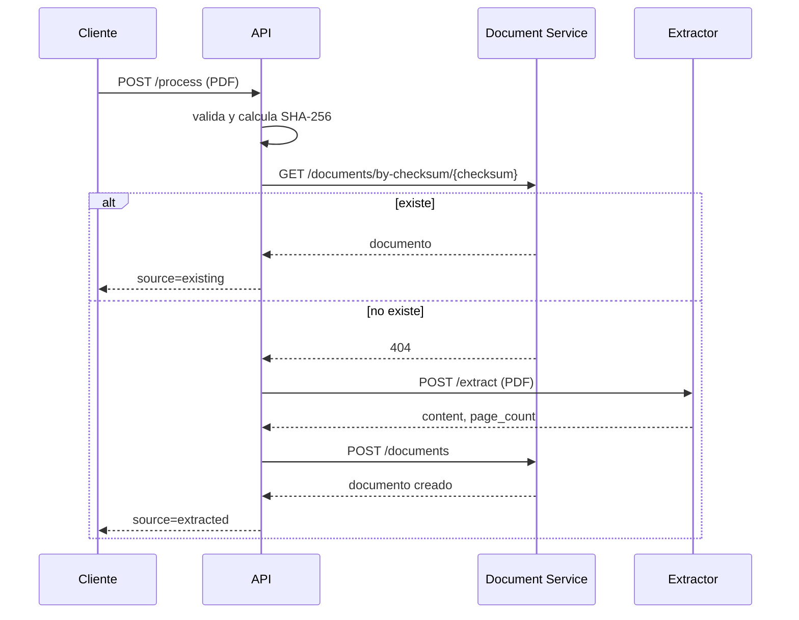

# pdf-api-service

API de entrada y orquestación para PDF-Extractext. Recibe un PDF, valida su formato y tamaño, calcula SHA-256, consulta si ya existe, llama al extractor cuando hace falta y persiste el resultado mediante Document Service. No extrae texto, no accede a MongoDB y no comparte código con otros repositorios.

## Flujo



El Document Service responde 201 cuando guarda un documento nuevo y 200 cuando el checksum ya estaba guardado. Si el POST de creación devuelve 409 por una carrera, la API vuelve a consultar por checksum y devuelve el documento existente.

## Endpoints

- `POST /process`: acepta `application/pdf` binario o `multipart/form-data` con campo `file`. En binario puede enviarse `X-Filename`; si el nombre no termina en `.pdf` se usa `document.pdf`.
- `GET /health`: liveness, sin consultar dependencias.
- `GET /ready`: consulta `/health` de extractor y Document Service.
- `/docs` y `/openapi.json`: contrato interactivo.

Ejemplos PowerShell:

```powershell
curl.exe -k -X POST https://api.universidad.localhost/process `
  -H "Content-Type: application/pdf" -H "X-Filename: informe.pdf" `
  --data-binary "@.\informe.pdf"

curl.exe -k -X POST https://api.universidad.localhost/process `
  -F "file=@.\informe.pdf;type=application/pdf"

curl.exe -k https://api.universidad.localhost/health
curl.exe -k https://api.universidad.localhost/ready
```

## Configuración

Copiar `.env.example` a `.env` para desarrollo y ajustar valores. No versionar `.env` ni secretos.

| Variable | Default | Uso |
|---|---:|---|
| `EXTRACTOR_URL` | `http://extractor:8000` | URL base del extractor |
| `DOCUMENT_SERVICE_URL` | `http://documents:8000` | URL base de documentos |
| `PORT` | `8000` | Puerto HTTP |
| `MAX_UPLOAD_BYTES` | `20971520` | Máximo de carga, 20 MiB |
| `EXTRACTOR_TIMEOUT_SECONDS` | `30` | Timeout de extracción |
| `DOCUMENT_TIMEOUT_SECONDS` | `5` | Timeout de llamadas a documentos |
| `READY_CHECK_TIMEOUT_SECONDS` | `2` | Timeout por health check |
| `MAX_CONCURRENT_REQUESTS` | `0` | Límite de procesos; cero desactiva backpressure |
| `LOG_LEVEL` | `INFO` | Nivel de logs a stdout |
| `TRAEFIK_API_HOST` | `api.universidad.localhost` | Host del router Traefik |

Dentro de Docker, usar DNS de servicio (`extractor`, `documents`), nunca `localhost`.

## Instalar, ejecutar y testear

Requiere Python 3.12 y `uv`:

```powershell
uv sync --locked
uv run --locked pytest -v
uv run uvicorn app.main:app --reload --port 8000
```

La suite no requiere servicios remotos; los mocks se hacen con `respx`. La prueba marcada `integration` se omite si no se definen `EXTRACTOR_URL` y `DOCUMENT_SERVICE_URL`.

## Docker y Traefik

```powershell
docker network create pdf-network
docker compose build
docker compose up -d --scale api=1
```

`pdf-network` debe existir como red externa y el Traefik de `pdf-infrastructure` debe estar conectado a ella. Los labels configuran un router HTTPS en `websecure` con TLS. Ajustar router, entrypoint, certificados/TLS y host a la instancia real de Traefik. El compose fija límites de 1 CPU y 512 MiB; no configura `container_name`, por lo que permite réplicas.

### Ejecución de desarrollo sin Traefik

Prerrequisitos:

- Crear la red externa una sola vez. Si ya existe, está bien:

  ```powershell
  docker network create pdf-network
  ```

- Tener la imagen `pdf-extractor-service:0.1.0`. Para construirla, ejecutar desde la raíz del repo del extractor (hoy el monolito `pdf-extractext`, donde existe `microservices/extractor`):

  ```powershell
  docker build --tag pdf-extractor-service:0.1.0 microservices/extractor
  ```

Desde este repo, levantar los servicios con ambos archivos Compose:

```powershell
docker compose -f docker-compose.yml -f docker-compose.dev.yml up --build
```

La API publica `127.0.0.1:8002`; el Document Service se simula con `tests/fakes/documents.py`. También hay un fake del extractor (`tests/fakes/extractor.py`) para pruebas independientes.

Para bajar los servicios:

```powershell
docker compose -f docker-compose.yml -f docker-compose.dev.yml down
```

## Prueba e2e por Traefik

Con los servicios arriba y un PDF local:

```powershell
.\scripts\e2e.ps1 -PdfPath .\informe.pdf
```

```bash
chmod +x scripts/e2e.sh
./scripts/e2e.sh ./informe.pdf
```

Los scripts esperan una primera respuesta `source=extracted` y la segunda `source=existing`; usar un documento que no haya sido cargado previamente.

## Errores

La forma pública es `{"error":"codigo","detail":"mensaje"}`. Los estados más comunes son 400 (PDF vacío o firma inválida), 413 (demasiado grande), 415 (tipo no soportado), 422 (validación o rechazo del extractor), 500 (error interno), 502 (otros errores upstream), 503 (servicio no disponible, respuesta 429 o 503 de un servicio upstream, o API saturada; incluye `Retry-After` si aplica) y 504 (timeout upstream). Los detalles internos y trazas no se devuelven al cliente; se registran a stdout con request-id.

## Decisiones y extensiones

La validación de frontera ocurre antes de llamar al extractor. SHA-256 se calcula en memoria y los bytes se envían directamente. Las llamadas de red comparten un único `httpx.AsyncClient` por ciclo de vida, con límites de conexiones y timeouts específicos por dependencia. `DocumentClient` concentra el contrato con Documents (ruta por checksum, `content` y `page_count`); ver [`docs/contracts.md`](docs/contracts.md).

No hay caché Redis. `ResultCache` y `NullResultCache` en `app/cache.py` dejan el punto de extensión; las mediciones baseline deben realizarse sin caché para no alterar los resultados.