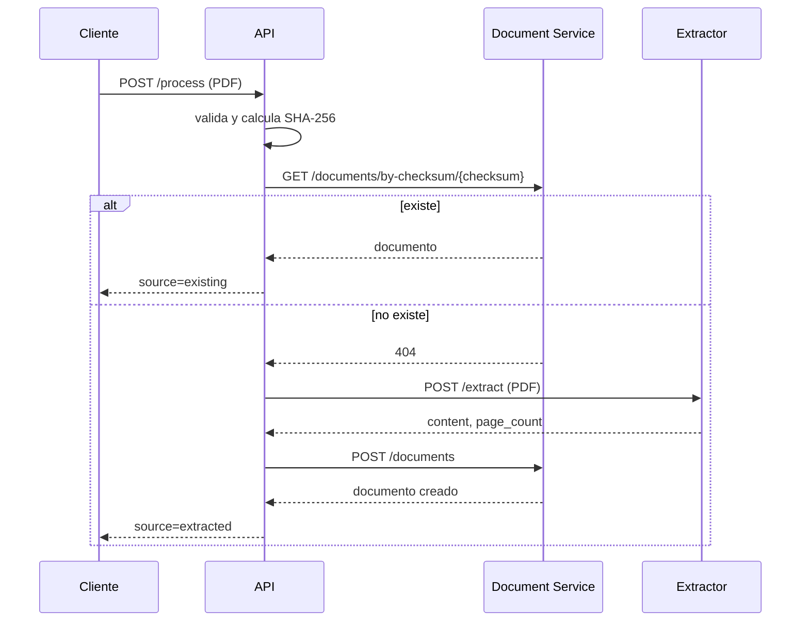

# pdf-api-service

API de entrada y orquestación para PDF-Extractext. Recibe un PDF, valida su formato y tamaño, calcula SHA-256, consulta si ya existe, llama al extractor cuando hace falta y persiste el resultado mediante Document Service. No extrae texto, no accede a MongoDB y no comparte código con otros repositorios.

## Flujo



El Document Service responde 201 cuando guarda un documento nuevo y 200 cuando el checksum ya estaba guardado. Si el POST de creación devuelve 409 por una carrera, la API vuelve a consultar por checksum y devuelve el documento existente.

## Endpoints

- `POST /process`: acepta `application/pdf` binario o `multipart/form-data` con campo `file`. En binario puede enviarse `X-Filename`; si el nombre no termina en `.pdf` se usa `document.pdf`.
- `GET /health`: liveness, sin consultar dependencias.
- `GET /ready`: consulta `/health/ready` de extractor y Document Service.
- `/docs` y `/openapi.json`: contrato interactivo.

Ejemplos PowerShell:

```powershell
curl.exe -X POST http://api.universidad.localhost/process `
  -H "Content-Type: application/pdf" -H "X-Filename: informe.pdf" `
  --data-binary "@.\informe.pdf"

curl.exe -X POST http://api.universidad.localhost/process `
  -F "file=@.\informe.pdf;type=application/pdf"

curl.exe http://api.universidad.localhost/health
curl.exe http://api.universidad.localhost/ready
```

El Compose de integración revisado de `pdf-infrastructure` publica el router de
la API en el entrypoint `web` (HTTP, puerto 80) y no configura TLS. Si el equipo
habilita TLS en otro entorno, usar su hostname y certificado configurados y
mantener la validación del certificado activa.

## Configuración

Copiar `.env.example` a `.env` para desarrollo y ajustar valores. No versionar `.env` ni secretos.

| Variable | Default | Uso |
|---|---:|---|
| `EXTRACTOR_URL` | `http://extractor:8000` | URL base del extractor |
| `DOCUMENT_SERVICE_URL` | `http://documents:8000` | URL base de documentos |
| `DOCUMENTS_API_TOKEN` | Vacío para fakes y revisiones históricas | Secreto compartido obligatorio al usar Documents con Bearer |
| `API_REQUIRE_AUTH` | `false` | Exige autenticación Bearer en `POST /process` cuando es `true` |
| `API_ACCESS_TOKEN` | Vacío | Credencial del cliente para `POST /process`, obligatoria en modo restringido |
| `PORT` | `8000` | Puerto HTTP |
| `MAX_UPLOAD_BYTES` | `20971520` | Máximo de carga, 20 MiB |
| `EXTRACTOR_TIMEOUT_SECONDS` | `30` | Timeout de extracción |
| `DOCUMENT_TIMEOUT_SECONDS` | `5` | Timeout de llamadas a documentos |
| `READY_CHECK_TIMEOUT_SECONDS` | `2` | Timeout por health check |
| `BODY_TIMEOUT_SECONDS` | `30` | Plazo total finito para recibir el cuerpo; vence con 408 |
| `MAX_CONCURRENT_REQUESTS` | `2` en Compose; `0` en Python local | Admisión inmediata; cero desactiva el límite |
| `LOG_LEVEL` | `INFO` | Nivel de logs a stdout |
| `TRAEFIK_API_HOST` | `api.universidad.localhost` | Host del router Traefik |
| `TRAEFIK_ENTRYPOINT` | `web` | Entrypoint HTTP confirmado |
| `TRAEFIK_TLS` | `false` | Habilitar solo con TLS configurado en Traefik |
| `DEV_PORT` | `8002` | Puerto publicado en 127.0.0.1 por el override dev |

Dentro de Docker, usar DNS de servicio (`extractor`, `documents`), nunca `localhost`.

Con Documents autenticado, inyectar el mismo `DOCUMENTS_API_TOKEN` en ambos
contenedores desde el entorno o el gestor de secretos. El Compose compartido
debe pasarlo expresamente a `api` y `documents`. La API usa la credencial para
las operaciones de documentos, incluidas las búsquedas por checksum. Health y
Extractor quedan fuera de ese intercambio. `/ready` comprueba disponibilidad
de las dependencias, así que el ensayo de la credencial requiere `/process`.
Con un PDF nuevo, esperar `source=extracted`. Repetir exactamente los mismos
bytes y verificar `source=existing`, con el mismo ID y checksum.

### Modo restringido para `POST /process`

Configurá `API_REQUIRE_AUTH=true` y `API_ACCESS_TOKEN` en el entorno de la
aplicación o en su `.env`. El Compose principal de este repositorio carga
`.env` mediante `env_file`. El token debe tener entre 32 y 512 caracteres
de `A-Z`, `a-z`, `0-9` o `._~+/-`, seguidos opcionalmente de uno o dos
`=`. Si falta, está vacío o tiene un formato inválido, la API rechaza el
arranque e identifica la variable sin mostrar el valor.

Enviá una sola cabecera `Authorization: Bearer <token>` para procesar un PDF.
Un fallo de autenticación devuelve `401` con `WWW-Authenticate: Bearer`
y un error JSON. `/health` y `/ready` siguen disponibles sin credencial.
`DOCUMENTS_API_TOKEN` se configura por separado para las llamadas a Documents.

Para la demo en PowerShell, usá el Compose aislado de este repositorio con
una credencial ficticia y el puerto local 8002 libre.

```powershell
$env:API_REQUIRE_AUTH = 'true'
$env:API_ACCESS_TOKEN = 'fake-demo-process-token-only-123456789'
$testProject = "pdf-api-auth-demo-" + [guid]::NewGuid().ToString("N").Substring(0, 8)
docker compose -p $testProject -f docker-compose.test.yml up --build -d

$baseUrl = 'http://127.0.0.1:8002'
curl.exe -i "$baseUrl/health"
curl.exe -i "$baseUrl/ready"  # Esperá a que responda 200 antes de enviar el PDF.
curl.exe -i "$baseUrl/process" -H 'Content-Type: application/pdf' `
  --data-binary '@tests/fixtures/sample.pdf'  # 401

$headers = @{ Authorization = "Bearer $env:API_ACCESS_TOKEN" }
1..2 | ForEach-Object {
  Invoke-RestMethod -Method Post -Uri "$baseUrl/process" -Headers $headers `
    -ContentType 'application/pdf' -InFile './tests/fixtures/sample.pdf' |
    Select-Object source, document_id, checksum
}

docker compose -p $testProject -f docker-compose.test.yml down
Remove-Item Env:API_REQUIRE_AUTH, Env:API_ACCESS_TOKEN
```

El primer envío autorizado devuelve `extracted` y el segundo `existing`,
con el mismo `document_id` y `checksum`.

## Instalar, ejecutar y testear

Requiere Python 3.12 y `uv`:

```powershell
uv sync --locked
uv run --locked pytest -v
uv run --locked uvicorn app.main:app --reload --port 8000
```

La suite unitaria usa mocks con `respx`. `tests/test_integration.py` se omite por defecto; para habilitarla hay que establecer `API_DEDICATED_TEST_ENV=1` y `API_TEST_URL` hacia un stack exclusivo con una base vacía. Usa el fixture local de una página `tests/fixtures/sample.pdf`; no es el conjunto oficial de carga del Extractor.

## Docker y Traefik

```powershell
docker compose config --quiet
docker compose -f docker-compose.yml -f docker-compose.dev.yml config --quiet
docker compose -p pdf-api-test-local -f docker-compose.test.yml config --quiet
docker compose build
```

`pdf-network` debe existir como red externa y el Traefik de `pdf-infrastructure` debe estar conectado a ella. Los labels usan `web` por HTTP y TLS desactivado, con router/service explícitos y `traefik.docker.network=pdf-network`. El arranque compartido corresponde al coordinador; no queda certificado por la prueba aislada. El compose fija límites de 1 CPU y 512 MiB; no configura `container_name`, por lo que permite réplicas.

### Pruebas aisladas con fakes

Stack propio, separado de servicios reales. Dev y test publican 8002: usar uno por vez.

```powershell
$testProject = "pdf-api-test-" + [guid]::NewGuid().ToString("N").Substring(0, 8)
docker compose -p $testProject -f docker-compose.test.yml up --build -d
curl.exe http://127.0.0.1:8002/ready
docker compose -p $testProject -f docker-compose.test.yml down
```

## Aceptación compartida reportada por Jeremías

Registrada el 06/11/2026, sin fecha de ejecución informada: Jeremías reporta `/health`, `/ready` y `/process` operativos por `http://api.universidad.localhost`, primer envío `extracted`, repetido `existing` con igual checksum y sin nuevas llamadas al Extractor, y aceptación del PDF de 279 páginas. También informa reconstrucción de solo API y `METRICS_ENABLED=true` en Extractor.

El mensaje no incluye commits desplegados, imagen ni logs. Es aceptación **reportada por Jeremías**, con trazabilidad pendiente; no una prueba ejecutada en esta revisión. Ver [alcance, faltantes y mensaje propuesto](docs/cierre-2026-11-04.md). No acredita TLS, cinco réplicas ni benchmark oficial. La evidencia aislada se conserva separada a continuación.

## Integración real en un entorno dedicado

La integración API → Extractor real → Documents real → MongoDB 7 se ejecutó el 29/10/2026. El resultado resumido está en [`integration/real-stack/results/2026-10-29-summary.json`](integration/real-stack/results/2026-10-29-summary.json). El 30/10/2026 se aceptó además el PDF original de 279 páginas; su evidencia está en [`integration/real-stack/results/2026-10-30-pdf279-summary.json`](integration/real-stack/results/2026-10-30-pdf279-summary.json). El Compose y los probes reproducibles están en [`integration/real-stack/README.md`](integration/real-stack/README.md); no dependen de la carpeta externa de logs. No se versionan PDFs originales ni generados durante las pruebas. El generador crea dos fixtures sintéticos pequeños en una carpeta ignorada; no son los PDFs oficiales de carga. `tests/fixtures/sample.pdf` es un fixture controlado versionado.

El stack de prueba usa su propia red interna, un servicio por réplica, caché del Extractor desactivada, métricas habilitadas y cliente interno. No publica puertos, no se conecta a `pdf-network` y no contiene Redis. Traefik es una instancia exclusiva con proveedor de archivo, sin dashboard ni socket Docker. La prueba confirmó esa ruta aislada; no valida el DNS, TLS ni el Traefik compartido.

Para reproducir la aceptación actual del 04/11/2026 en Windows PowerShell, con los tres checkouts ya disponibles y los commits de Extractor/Documents indicados en la guía, reemplazar la ruta de ejemplo de `-PdfPath` por la ubicación del PDF original de 279 páginas:

```powershell
.\integration\real-stack\run.ps1 `
  -ApiRepoPath (Resolve-Path .).Path `
  -ExtractorRepoPath 'C:\dev\pdf-proyecto\pdf-extractor-service-review' `
  -DocumentsRepoPath 'C:\dev\pdf-proyecto\pdf-document-service-review' `
  -PdfPath 'C:\ruta-de-ejemplo\pdf279hojas.pdf' `
  -CurrentDocumentsSnapshot -RunIntegration
```

El script valida remoto y commit de los clones hermanos, genera los fixtures, valida la configuración aislada, construye y levanta el stack, ejecuta el flujo, registra resultados bajo `integration/real-stack/run/` y limpia contenedores/red en un bloque `finally`. Las imágenes se conservan. Si la consola se interrumpe antes de completar la limpieza, ejecutar `.\integration\real-stack\run.ps1 -CleanupOnly`.

Los scripts `scripts/e2e.ps1` y `scripts/e2e.sh` siguen sirviendo para un endpoint dedicado publicado/alcanzable desde el host. No apuntarlos al Compose de integración anterior: ese cliente no publica puertos y accede a la API desde su red interna.

## Errores

La forma pública es `{"error":"codigo","detail":"mensaje"}`. Los estados más comunes son 400 (PDF vacío, firma, Content-Length o multipart inválidos), 408 (plazo de recepción agotado), 413 (demasiado grande), 415 (tipo no soportado), 422 (validación o rechazo del extractor), 500 (error interno), 502 (otros errores upstream), 503 (servicio no disponible, respuesta 429 o 503 de un servicio upstream, o API saturada; incluye `Retry-After` si aplica) y 504 (timeout upstream). Los detalles remotos e inputs no se devuelven ni se registran. Los logs propios incluyen código/tipo de error y request-id; también el 500 devuelve X-Request-ID.

## Decisiones y extensiones

La validación de frontera ocurre antes de llamar al extractor. SHA-256 se calcula en memoria y los bytes se envían directamente. Las llamadas de red comparten un único `httpx.AsyncClient` por ciclo de vida, con límites de conexiones y timeouts específicos por dependencia. `DocumentClient` concentra el contrato con Documents (ruta por checksum, `content` y `page_count`); ver [`docs/contracts.md`](docs/contracts.md).

La API no usa caché Redis; la medición baseline se realiza sin caché para no alterar los resultados.

## Contrato actualizado

source expresa creación/existencia: POST Documents 201 produce extracted, POST 200 produce existing. En una carrera puede haber extracción previa al duplicado. 409 excepcional provoca reconsulta.
El límite de 20971520 bytes es sobre todo el cuerpo, incluido el envoltorio multipart. PORT se aplica a Uvicorn, healthcheck, destino de Traefik y puerto interno del override dev.
Extractor 400/415: API 422; 413: 413; 429/503: 503. Timeout: 504; conexión/respuesta inválida: 502. No se devuelve detail remoto. Logging a stdout.

## Carga simple de la API

El runbook de [`integration/real-stack`](integration/real-stack/README.md) ejecuta la carga breve dentro de la red interna: 1 worker, 5 segundos, PDF repetido. El 29/10/2026 obtuvo 29 respuestas, 0 errores y todas `existing` (5,79 requests/s; p50 18,3 ms; p95 73,6 ms). Mide principalmente deduplicación, no extracción de PDFs nuevos ni el benchmark oficial del Extractor. `scripts/check_api.py` permite repetir la carga contra un endpoint expresamente dedicado; no usar el despliegue compartido.

## Cierre de frontera y ciclo de vida (04/11/2026)

Pydantic v2 valida PORT 1..65535, tamaño positivo, timeouts positivos finitos, concurrencia no negativa y URLs HTTP/HTTPS con host. Se admite localhost fuera de Docker; dentro de Docker usar DNS de servicio. No se aceptan credenciales, query ni fragmentos en URLs base.

El máximo predeterminado de **20 MiB (20.971.520 bytes) cuenta todo el cuerpo HTTP**, incluido el envoltorio multipart: un PDF binario de exactamente ese tamaño cabe; el mismo PDF dentro de multipart excede el límite. Content-Length inválido o excesivo se rechaza antes de leer; el conteo real por chunks sigue activo aunque falte o subestime el tamaño. BODY_TIMEOUT_SECONDS cuenta toda la recepción, sin reiniciarse por chunk. El 408 devuelve `{"error":"body_timeout","detail":"Se agotó el tiempo para recibir el cuerpo."}`.

Multipart admite una única parte `file`, sin campos adicionales, partes anidadas ni Content-Transfer-Encoding. Exige boundary y cierre válidos. Conserva los bytes binarios y no escribe PDFs temporales. El nombre pierde directorios y caracteres de control, se recorta a 255 caracteres y usa document.pdf si queda vacío o no termina en .pdf. Nunca se usa para escribir archivos.

Extractor solo tiene éxito con 200; consulta Documents con 200 o 404; creación Documents con 201/200 y 409 excepcional para reconsulta. Documents 413 se conserva como **API 502**: describe un resultado upstream que no puede persistirse, no un exceso del cuerpo PDF recibido. El máximo BSON y el tamaño del Markdown no equivalen al límite de carga. Hay regresión de esta decisión y comprobación directa contra Documents actual.

Compose concede 30 s de apagado y Uvicorn espera hasta 20 s por solicitudes pendientes; `init: true` reenvía señales. Una petición que excede ese margen puede cancelarse. El cliente HTTP compartido se cierra mediante lifespan. Se conserva el contador con lock y liberación en finally ante éxito, error y cancelación. La saturación responde inmediatamente 503 con Retry-After: 1. /health no llama servicios remotos. No se añadieron señales propias ni readiness de drenado: el servidor real deja de aceptar conexiones durante shutdown.

El valor inicial de entrega es MAX_CONCURRENT_REQUESTS=2 con 1 CPU/512 MiB. La evidencia y los límites de la medición breve se registran en [el cierre de auditoría](docs/cierre-2026-11-04.md). No representa capacidad máxima ni garantiza el tamaño de cualquier respuesta upstream. Para desactivar explícitamente usar 0.

SOLID/Clean Code: la frontera valida entrada, el orquestador decide el flujo, los clientes contienen contratos HTTP y los schemas validan datos. Los protocolos existentes permiten probar el orquestador sin red (inversión de dependencias); cada capa tiene una responsabilidad. Se conservaron estas capas y las dependencias bloqueadas, sin fábricas ni interfaces nuevas, sin reintentos POST y sin Redis en la API.
